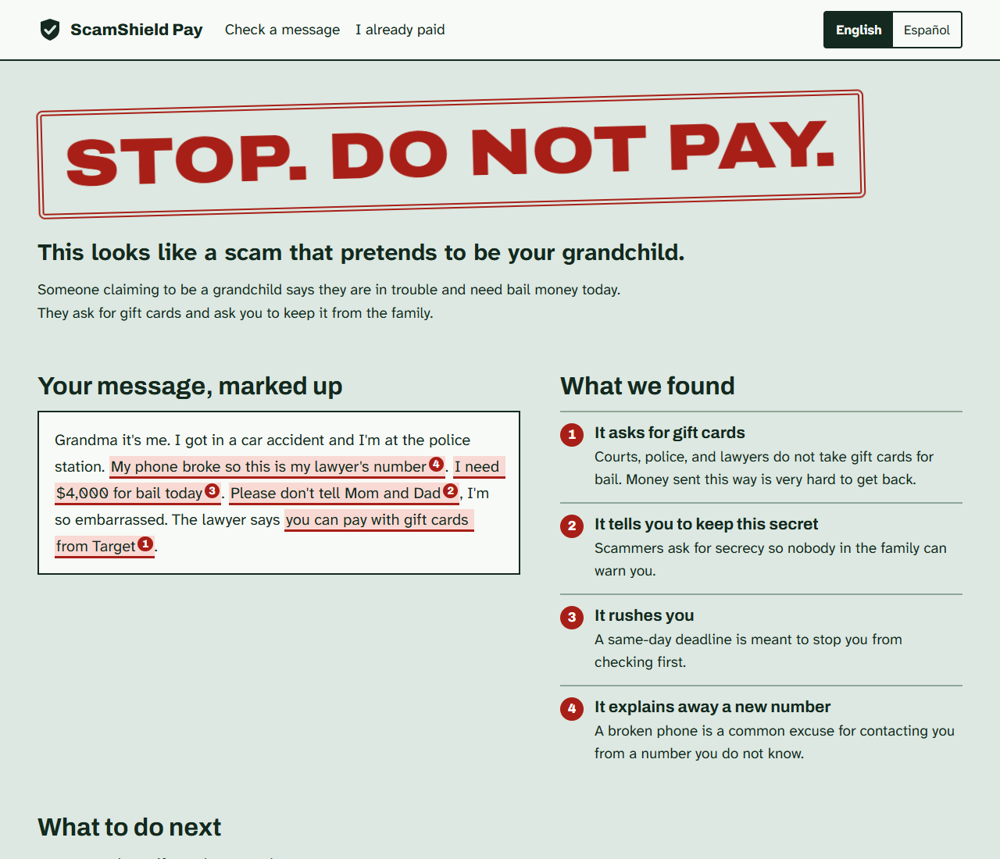
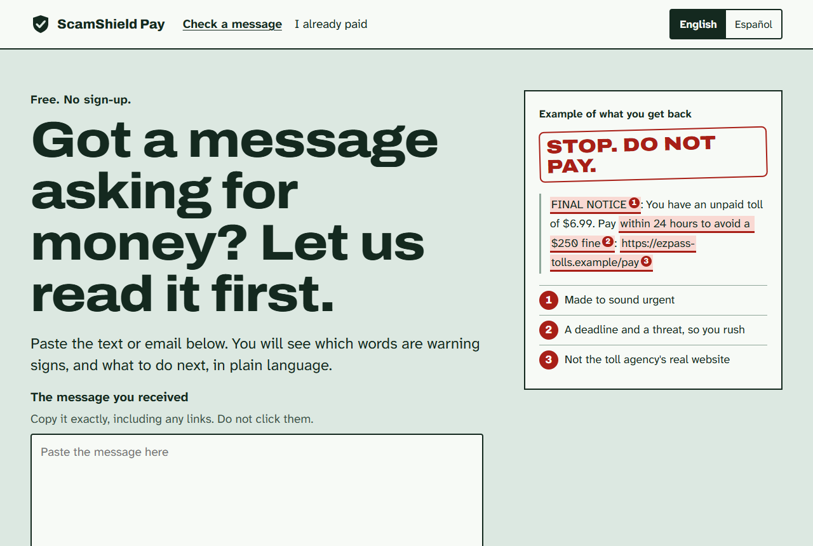
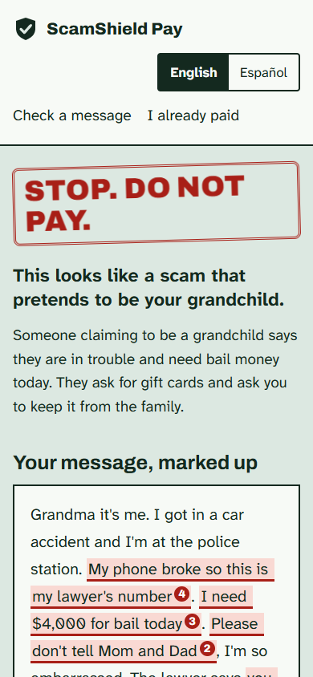

# ScamShield Pay

[](https://github.com/matt869/scamshield-pay/actions/workflows/ci.yml)

Paste a suspicious text or email and get a free, plain-language verdict before any money moves. People who already paid get a free step-by-step guide, and can buy a dispute kit: a letter, a phone script, and an evidence checklist written for their case.

English and Spanish. Built with Next.js, Claude, and PayPal.



<table>
  <tr>
    <td width="68%"></td>
    <td width="32%"></td>
  </tr>
</table>

<sub>Screenshots use the built-in sample message with an example report.</sub>

## Run it

```bash
npm install
cp .env.example .env.local   # then fill in the values below
npm run dev                  # http://localhost:3000
```

| Variable | Needed for | Where to get it |
| --- | --- | --- |
| `ANTHROPIC_API_KEY` | Checks and dispute kits | [Claude Console](https://platform.claude.com/) |
| `PAYPAL_CLIENT_ID`, `PAYPAL_CLIENT_SECRET` | Taking payment | [PayPal developer dashboard](https://developer.paypal.com/dashboard/applications), Sandbox app to start |
| `PAYPAL_WEBHOOK_ID` | Invoices, pending payments, refunds | See "PayPal webhook" below |
| `PAYPAL_ENV` | `sandbox` or `live` | Defaults to sandbox |
| `APP_URL` | The link inside invoice emails | Your public URL |
| `KIT_PRICE_USD` | Kit price, like `9.00` | Your decision |

Without Claude credentials the check reports that it is unavailable and tells the reader not to pay yet. Without PayPal credentials the pay page says payments are unavailable. The help page needs neither.

### PayPal webhook

Create a webhook in your PayPal app pointing at `https://YOUR-DOMAIN/api/paypal/webhook` and put its ID in `PAYPAL_WEBHOOK_ID`. Sandbox and live have different IDs. Subscribe to:

- `PAYMENT.CAPTURE.COMPLETED`
- `PAYMENT.CAPTURE.REFUNDED`
- `PAYMENT.CAPTURE.REVERSED`
- `INVOICING.INVOICE.PAID`
- `INVOICING.INVOICE.REFUNDED`

Without the webhook, immediate PayPal and card payments still unlock the kit, but paid invoices and payments that clear later never do, and refunds never close it. PayPal's Webhooks simulator sends mock events that cannot pass signature verification, so test with real sandbox payments.

## How it works

```
Message ─ POST /api/analyze ─ Claude ─ guardrails ─ store ─ /result
                                                              │
                     free guide: /help  ◄─────────────────────┤
                                                              ▼
 /pay ─ create-order ─ PayPal ─ capture-order ─ checks ─ paid ─ /success ─ POST /api/dispute ─ kit
   └─── create-invoice ─ PayPal email ─ webhook ─ checks ─ paid ─┘
```

| Path | What it holds |
| --- | --- |
| `lib/claude.ts` | Claude calls and the schema sent to the API |
| `lib/prompts/` | The classifier and dispute-letter prompts |
| `lib/guardrails.ts` | Rules that hold whatever the model returns |
| `lib/paypal.ts` | PayPal REST client and payment verification |
| `lib/store.ts` | Records and retention |
| `lib/i18n.ts` | All interface copy, in both languages |
| `data/resources.json` | Official contacts and per-payment-method guidance |

### Safety decisions worth keeping

The message being judged may be written by a criminal, and the worst failure is false reassurance.

- **No verdict is better than a guessed one.** If Claude refuses, errors, or returns something outside the schema, the reader is told we could not check it and not to pay yet.
- **Guardrails run after the model.** Demands for gift cards or crypto, remote-access tools, requests for secrecy, and text aimed at an AI checker all raise a "low" verdict to "medium". Next steps containing links or phone numbers are dropped, because they could come from the sender. Quotes not found in the message are not marked.
- **"Low" never means safe.** The page always says we cannot confirm who sent the message.
- **Nothing from the message is clickable.** It is rendered as plain text.
- **The browser never decides a payment.** The server sets the price, and the kit unlocks only after PayPal's own response matches the check, amount, and currency. Webhooks are signature-verified and invoice state is re-fetched from PayPal. A refunded kit stays closed.
- **Emergency help is never behind the paywall.** The guide and official contacts are free.

## Tests

```bash
npm test            # guardrails, marking, payment and webhook rules
npm run typecheck
```

These use mocked PayPal responses and do not call Claude. GitHub Actions runs the type check, tests, and a production build on every push.

## Deploying

`lib/store.ts` writes a JSON file (`STORE_FILE`, default `.data/store.json`), so as written the app needs **one long-running server with a persistent disk**, such as a small VPS, Fly.io, or Render with a volume. On serverless hosting such as Vercel the file does not persist and instances do not share it: results and payment records would be lost. To deploy there, replace `lib/store.ts` with a database; nothing else touches the file. The rate limiter in `lib/rate-limit.ts` is also per process.

Rate limits are per client address taken from `x-forwarded-for`, so run behind a proxy that sets it, such as nginx or your host's load balancer. Without one, every visitor shares a single limit of 10 checks an hour.

### Before taking real money

- [ ] Test the full flow against the PayPal sandbox and a real Claude key.
- [ ] Add a privacy policy and terms, including a refund policy. The app stores submitted messages for 24 hours, or 30 days once an invoice is sent or a kit is paid for.
- [ ] Have a lawyer review the dispute kit and the payment-deadline guidance in `data/resources.json`.
- [ ] Have a native speaker review the Spanish.
- [ ] Decide on a license. `LICENSE` currently reserves all rights, so the public code is for viewing only.
- [ ] Back up the store file, and set `PAYPAL_ENV=live` with live credentials and a live webhook ID.
